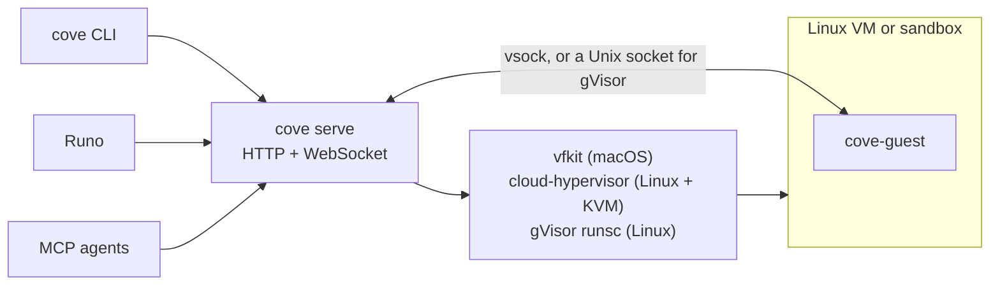

<div align="center">

# Cove

**Self-hosted microVMs for people and coding agents.**

Fast, persistent Linux VMs on your Mac, your Linux server or a cheap VPS,
driven from a CLI, an HTTP API or MCP.

[](https://github.com/deltalark/cove/actions/workflows/ci.yml)
[](LICENSE)


[Why Cove](#why-cove) · [Install](#install) · [Where it runs](#where-cove-runs) · [Quick start](#quick-start) · [CLI](#cli) · [API](#http-api) · [MCP](#mcp) · [Secrets and egress](#secrets-and-the-allowlist) · [Runo](#cove-and-runo) · [How it works](#how-it-works)

</div>

---

```console
$ curl -fsSL https://raw.githubusercontent.com/deltalark/cove/main/scripts/install.sh | sh
$ cove up dev --mount ~/code/myapp:/work
$ cove shell dev --cwd /work
root@dev:/work# cargo test
```

One line installs it on a Mac, a Linux server with KVM, or a cheap VPS without it. Every VM is a real Linux machine that sees only the folders you share, reaches only the hosts you allow, and never holds your API keys.

## Why Cove

Coding agents are most useful when you let them run commands freely, and most dangerous for the same reason. Cove gives every agent, or every person, a real Linux machine of its own that boots in seconds, keeps its state, and can only see what you hand it.

- **Real Linux VMs.** Debian 13, and you are root. Every VM boots from a shared base image, and its disk is a copy-on-write clone, so a new VM costs almost no disk until it changes things.
- **Live shared folders.** Share host folders into the VM. Edit on your Mac and build in the VM, or the other way round.
- **Processes that outlive your connection.** `cove spawn` starts a named process in the VM. Disconnect, come back later, and `cove attach` replays what you missed and keeps streaming. Agents keep working while your laptop sleeps.
- **Ports in one command.** See what is listening inside a VM and forward it to your machine.
- **Built for agents.** An MCP server lets any agent create VMs, run commands, start and watch background jobs, move files and share ports.
- **Real isolation.** A VM sees only the folders you share. Commands an agent runs there can't touch your home folder, keychain or SSH keys. Turn its network off entirely for code you don't trust.
- **Keys never enter the VM.** Give a VM your API keys and tokens as secrets: inside, it sees only placeholders, and Cove's proxy adds the real values to HTTPS requests for the hosts each secret belongs to. An agent can't leak what it never had.
- **Only the hosts you allow.** With `--network allowlist` a VM has no network device at all and reaches only the hosts on its list, through Cove's proxy. Every connection it tries is logged, so you can see what an agent reached and what was blocked.
- **Stops when you're done.** Give a VM an idle timer and it stops by itself once nothing has used it for that long, so forgotten agent VMs don't hold on to memory.

## Install

**On a Mac** (Apple Silicon):

```sh
curl -fsSL https://raw.githubusercontent.com/deltalark/cove/main/scripts/install.sh | sh
```

**On a Linux server or VPS** (as root, since VMs with a network need it):

```sh
curl -fsSL https://raw.githubusercontent.com/deltalark/cove/main/scripts/install.sh | sudo sh
```

What the script does:

- Puts `cove` and the guest agent in `~/.cove/bin`, from the latest release (or builds from source with cargo when no release fits), and links `cove` into `/opt/homebrew/bin` or `/usr/local/bin` so apps find it too.
- **Mac:** installs vfkit with Homebrew if it is missing, and starts `cove serve` at login with a launchd agent.
- **Linux with KVM:** installs cloud-hypervisor (the official static build) if it is missing, and virtiofsd, iptables and iproute2 from your distribution.
- **Linux without KVM:** asks to install gVisor (the official release, checksum checked) and uses that. Say no and you get just the CLI, to drive a Cove server elsewhere with `--host`.
- On Linux, installs a systemd service for `cove serve`; then runs `cove doctor` and pulls the Debian 13 image. For gVisor that image comes from Docker Hub, and from Google's mirror of it (`mirror.gcr.io`) when Docker Hub's anonymous pull limit refuses a shared VPS address, with every layer checked against its digest either way.

Running it again upgrades in place. Your VMs, images and API key live in `~/.cove` and are left alone. Options go after `sh -s --`, for example `| sh -s -- --no-service`: `--prefix DIR`, `--version TAG`, `--listen ADDR`, `--no-service`, `--no-image`, `--no-link`, `--no-deps`, `--gvisor` / `--no-gvisor`, `--from-source`, `--from-file TARBALL`.

Check the result with `cove doctor`, which lists what each backend needs, what is missing and how to fix it, and which backend `auto` will pick.

**Connecting Runo.** Runo finds the Cove on your Mac by itself. For a server, run `cove key` there, then in Runo add a Cove connection with the server's URL and that key. The API is plain HTTP and listens on `127.0.0.1:7457` by default, so reach it through an SSH tunnel (`ssh -L 7457:127.0.0.1:7457 my-server`, then use `http://127.0.0.1:7457`), or put an HTTPS reverse proxy in front of it before you open it up with `--listen`.

**Uninstall** with `install.sh --uninstall` (`curl … | sh -s -- --uninstall`). It stops the service and removes the binaries, and keeps `~/.cove`; add `--purge` to stop every VM and delete `~/.cove` too.

## Where Cove runs

| Host | Backend | Isolation | Good to know |
| --- | --- | --- | --- |
| macOS on Apple Silicon | `vfkit`: Apple's Virtualization.framework | A real VM with its own kernel | The original backend: fast boots, virtio-fs folders. |
| Linux with KVM (bare metal, or a VPS with nested virtualization) | `cloud-hypervisor` | A real VM with its own kernel | The same Debian disk as on a Mac, booted with EFI. Folders through virtiofsd, a tap device and NAT per VM. Needs root for networking. |
| Linux without KVM (most cheap VPS plans) | `gvisor`: gVisor sandboxes | Each VM gets gVisor's own kernel in user space, between its processes and the host's kernel | Boots in about a second and needs no KVM. Weaker than a hardware VM but much stronger than a container. `--disk` isn't enforced, and there is no systemd inside: processes run under the guest agent. Needs root. |

`--backend auto`, the default, picks the strongest one the machine has: Apple's VMs on a Mac; on Linux, cloud-hypervisor when `/dev/kvm` is usable, otherwise gVisor when it is installed. If neither is there, Cove says how to install gVisor. Each VM keeps the backend it was created with, and `cove doctor` lists what each backend needs and which one `auto` picks.

On Linux, VMs with the network on get their own /30 in `10.177.0.0/16` with NAT to the internet. They can't reach each other, the host's own services, or the cloud metadata endpoint (`169.254.0.0/16`), which on many providers hands out the server's credentials.

## Quick start

With Cove installed and `cove serve` running (the installer starts it):

```sh
cove doctor                                  # what works on this machine
cove up dev --mount ~/code/myapp:/work       # create and start a VM
cove shell dev --cwd /work                   # a root shell inside it
```

Want to check a machine end to end? `scripts/smoke-vm.sh` boots a VM and tests exec, shared folders, networking, ports, restarts, copies and `--network off`, on any backend.

## CLI

| Command | What it does |
| --- | --- |
| `cove serve [--listen 127.0.0.1:7457]` | Run the server |
| `cove doctor` | Check the host setup |
| `cove key` | Print the API key |
| `cove image ls` · `cove image pull <image>` | List and download base images |
| `cove up <name> [options]` | Create and start a VM (options below) |
| `cove ls` · `cove show <name>` | List VMs, or show one |
| `cove start <name>` · `cove stop <name>` · `cove rm <name>` | Start, stop or delete a VM |
| `cove copy <from> <to>` | Clone a VM |
| `cove exec <name> [-t] [--cwd DIR] [-e K=V]... -- <command...>` | Run a command and wait for it |
| `cove shell <name> [--cwd DIR]` | Open an interactive shell |
| `cove spawn <name> <proc> [-t] [-a] -- <command...>` | Start a named background process |
| `cove attach <name> <proc> [--from BYTES]` | Reattach to a process and replay its output |
| `cove procs <name>` · `cove kill <name> <proc>` | List or stop processes |
| `cove push <name> <local> <remote>` · `cove pull <name> <remote> <local>` | Copy files in and out |
| `cove ports <name>` · `cove forward <name> <port>` | List ports and forward one |
| `cove egress <name>` | What a VM may reach, its secrets (names only), and what it tried to reach |
| `cove allow <name> [rules...]` | Replace a VM's allowlist; a running VM uses it straight away |
| `cove mcp` | Run the MCP server over stdio |
| `cove version` | Print the client's version, and the server's version and features |

`cove up` takes:

| Option | Default | What it does |
| --- | --- | --- |
| `--cpus N` | `2` | Virtual CPUs |
| `--memory MB` | `4096` | Memory |
| `--disk GB` | `20` | Disk size |
| `--mount HOST:GUEST[:ro]` | | Share a folder; repeat for more |
| `--backend NAME` | `auto` | `auto`, `vfkit`, `cloud-hypervisor` or `gvisor` (see [Where Cove runs](#where-cove-runs)) |
| `--network full\|off\|allowlist` | `full` | `full` is NAT to your network and the internet. `off` gives the VM no network device at all (a gVisor sandbox gets loopback only); Cove still reaches it over its own channel. `allowlist` has no network device either, and reaches only the `--allow` hosts through Cove's proxy (see [Secrets and the allowlist](#secrets-and-the-allowlist)) |
| `--allow RULE` | `@dev` with `allowlist` | A host the VM may reach: `example.com`, `*.example.com` (its subdomains), `*`, or a preset: `@dev` (git hosts, package registries, Debian mirrors and model APIs) or `@agents` (model APIs and their sign-in hosts). Repeat for more |
| `--secret NAME[@HOSTS]` | | Take `NAME` from your environment and keep it out of the VM; see below. Repeat for more |
| `--idle-stop MINUTES` | off | Stop the VM after this many minutes with no commands, open streams, forwarded connections or running named processes |
| `--ephemeral` | | Delete the VM when it stops |
| `--tag T` | | Free-form labels; repeat for more |

`cove exec` and `cove shell` start a stopped VM by themselves. With `--create` they also create a missing one, taking `--mount`, `--cpus`, `--memory`, `--backend`, `--network` and `--idle-stop` as above. `cove ls` shows each VM's network policy and idle timer.

`cove exec` passes stdin through byte for byte and closes the command's stdin when yours ends, so `echo hi | cove exec dev -- cat` prints `hi`, and binary protocols such as `git upload-pack` run through it unchanged. Output waits for a slow reader instead of being dropped.

Add `--json` to any command for machine-readable output, and `--host URL` to talk to another Cove server.

## HTTP API

Every request carries `Authorization: Bearer <key>`. The key is created on first start in `~/.cove/api-key`, and `cove key` prints it.

| Method | Path | Notes |
| --- | --- | --- |
| `GET` | `/v1/health` | No auth. `ok, version, protocol, backend, features` |
| `GET` | `/v1/images` | |
| `POST` | `/v1/images/{name}/pull` | |
| `GET` `POST` | `/v1/vms` | POST takes `name, image, cpus, memory_mb, disk_gb, mounts, ephemeral, tags, backend, network, allow, secrets, idle_stop_minutes, start`. `secrets` is a list of `{name, value, hosts}`; responses list only their names and hosts |
| `GET` `DELETE` | `/v1/vms/{name}` | |
| `POST` | `/v1/vms/{name}/start`, `/stop`, `/copy` | |
| `POST` | `/v1/vms/{name}/exec` | Runs to completion and returns `code, stdout, stderr` |
| `GET` (WebSocket) | `/v1/vms/{name}/stream` | First message is an `exec`, `spawn` or `attach` request; then frames out, input in |
| `GET` | `/v1/vms/{name}/procs` | |
| `DELETE` | `/v1/vms/{name}/procs/{proc}` | `?signal=` |
| `GET` `PUT` | `/v1/vms/{name}/files?path=` | Raw bytes; PUT takes `&mode=755` |
| `GET` | `/v1/vms/{name}/dir?path=` | |
| `GET` | `/v1/vms/{name}/ports` | Listening ports and forwards |
| `POST` `DELETE` | `/v1/vms/{name}/forwards`, `/forwards/{port}` | |
| `GET` `PUT` | `/v1/vms/{name}/egress` | `network, enforced, allow, secrets` (names and hosts) and `log`, the latest 200 connections with `host, port, allowed, reason, secrets`. PUT (or POST) `{"allow": [...]}` replaces the allowlist |

The stream's frames and requests are the types in [`crates/proto`](crates/proto/src/lib.rs).

A VM's `backend` is `"auto"` (the default) or a backend's name, `network` is `"full"` (the default), `"off"` or `"allowlist"`, and `idle_stop_minutes` is a whole number of minutes, or left out for no timer. All three come back in every VM's status, `backend` as the one it got.

`/v1/health` tells a client what the server can do before it relies on it:

```json
{ "ok": true, "version": "0.1.0", "protocol": 1, "backend": "gvisor",
  "features": ["network", "idle-stop", "spawn", "attach", "forward", "copy", "files", "stdin-eof",
               "egress", "backend:gvisor"] }
```

`backend` is what `auto` picks (or `null` when nothing can run VMs), and each `backend:<name>` feature is a backend that works on this server. Features are only ever added, so check for the one you need rather than comparing versions.

```sh
curl -s -H "Authorization: Bearer $(cove key)" -H "Content-Type: application/json" \
  -d '{"cmd":["uname","-a"]}' http://127.0.0.1:7457/v1/vms/dev/exec
```

## MCP

Give any MCP-capable agent its own machines:

```json
{ "mcpServers": { "Cove": { "command": "cove", "args": ["mcp"] } } }
```

| Tool | What it does |
| --- | --- |
| `vm_list` | List VMs |
| `vm_create` | Create and start a VM: `name`, and optionally `cpus`, `memory_mb`, `ephemeral`, `network` (`full`, `off` or `allowlist`), `allow` and `idle_stop_minutes` |
| `vm_egress` | What a VM may reach, its secrets' names, and the hosts it recently reached or was refused |
| `vm_exec` | Run a command and wait for it: `name`, `command`, `cwd` |
| `vm_spawn` | Start a named background process that keeps running: `name`, `proc`, `command`, `cwd` |
| `vm_logs` | A named process's output so far and whether it is still running, without waiting: `name`, `proc`, `from` (byte offset; each reply gives the next one) |
| `vm_kill` | Signal a named process: `name`, `proc`, `signal` (SIGTERM by default) |
| `vm_read_file` · `vm_write_file` | Read and write files |
| `vm_share_port` | Forward a port to the host |
| `vm_stop` · `vm_start` | Stop a VM, keeping its disk, or start it again |
| `vm_copy` | Copy a stopped VM to a new name: `name`, `to` |
| `vm_destroy` | Delete a VM |

Agents can use `vm_spawn` and `vm_logs` for anything slower than a quick command: a build, a test suite, a dev server. Shell commands run as `bash -lc`.

On purpose, MCP can't give a VM secrets or change an allowlist after the VM is made: an agent shouldn't be able to widen its own sandbox or hand your keys to a host of its choosing. People do that with the CLI or the API.

## Secrets and the allowlist

```console
$ export ANTHROPIC_API_KEY=sk-ant-…
$ cove up agent --mount ~/code/app:/work --network allowlist --allow @dev \
    --secret ANTHROPIC_API_KEY --secret GH_TOKEN
$ cove exec agent -- sh -c 'echo $ANTHROPIC_API_KEY'
sk-ant-api03-cove5f0c…            # a placeholder, not your key
$ cove egress agent
Network: allowlist. Reaches only: @dev
Secret ANTHROPIC_API_KEY goes only to api.anthropic.com
Secret GH_TOKEN goes only to github.com, api.github.com

api.anthropic.com                          443  allowed, added ANTHROPIC_API_KEY
registry.npmjs.org                         443  allowed
evil.example                               443  BLOCKED: not on this VM's allowlist
```

How it works:

- **The proxy runs in `cove serve`, outside the VM.** Every command in the VM gets `HTTP_PROXY` and `HTTPS_PROXY` pointing at `127.0.0.1:3128` inside the VM, where the guest agent hands each connection to the server over its own channel. So an `allowlist` VM needs no network device, and on Linux no root for networking either.
- **Secrets.** `--secret NAME` reads `NAME` from your environment (never from the command line, so it stays out of your shell history). The VM gets a placeholder that keeps the key's public prefix (`sk-ant-api03-`, `ghp_`), since some CLIs check it. For requests to that secret's hosts, the proxy terminates TLS with a certificate from Cove's own authority, which it installs in the VM, replaces the placeholder in the request headers (including inside `Basic` credentials, which is how git sends tokens), and sends the request on to the real server over TLS. Well-known names know their hosts: `ANTHROPIC_API_KEY`, `CLAUDE_CODE_OAUTH_TOKEN` and `ANTHROPIC_AUTH_TOKEN` go to `api.anthropic.com`, `OPENAI_API_KEY` and `CODEX_API_KEY` to `api.openai.com`, `OPENROUTER_API_KEY` to `openrouter.ai`, `GEMINI_API_KEY` and `GOOGLE_API_KEY` to `generativelanguage.googleapis.com`, `GH_TOKEN` and `GITHUB_TOKEN` to `github.com` and `api.github.com`, `GITLAB_TOKEN` to `gitlab.com`. Name others with `--secret NAME@host,host`.
- **Everything else passes straight through.** HTTPS to hosts without secrets is a plain `CONNECT` tunnel: the proxy checks the host name and never sees the traffic.
- **What's never reachable:** this machine's own addresses and link-local ones such as the cloud metadata service. Private networks are reachable only for hosts allowed by exact name, so `*` doesn't open your LAN.
- **With `--network full`**, secrets still work the same way, but the allowlist isn't enforced, since the VM has its own route out.
- **Limits:** secrets are added to request headers only, over HTTPS. Brokered connections speak HTTP/1.1 (streaming responses work; WebSocket upgrades don't yet). Programs that ignore the proxy variables can't reach the network at all in an `allowlist` VM.

## Cove and Runo

Cove is built to work hand in hand with [Runo](https://github.com/deltalark/runo), the native app for running coding agents side by side. In Runo, a Cove server is a **Connection**: the one on your Mac, or a remote one added with its URL and API key (`cove key` on that machine prints it). Every session picks where it **Runs on**, your Mac or any connection, and can move between them at any time between agent turns.

**On your Mac's Cove**, a session gets a VM of its own and its worktree is shared into the VM at the same path. The agent, the worktree setup command and terminal tabs run in the VM, while git, diffs, commits and pull requests keep running on the Mac against the same files. Moving a session between the Mac and the VM is instant, because there is nothing to copy.

**On a remote Cove server**, the VM keeps its own copy of the worktree, and Runo syncs it in and out through git after every agent turn, uncommitted changes included. Git's data travels through `cove exec` itself, so the VM never needs access to GitHub just to sync. The agent's conversation travels with the worktree, so you can move a session from your laptop to a VM on a server, close the laptop, and later bring it back: the agent resumes the same conversation wherever it runs.

**Runo's Cove settings** choose each connection's VM size, its network policy (`full`, or `off` for agents that shouldn't reach the internet) and its idle stop, so VMs on a server stop by themselves once their sessions go quiet. Only the API keys you list reach a VM, and deleting a session deletes its VM.

**Agents keep going without you.** On a Cove server, Runo runs each agent turn as a Cove named process (`cove spawn`) and follows its output. Close your laptop and the turn keeps running in the VM; when Runo opens again it reattaches, replays what you missed and brings the work back.

**Agents use Cove too.** Through `cove mcp`, an agent in Runo can make scratch VMs of its own: to research something without touching the session's worktree, to run code it doesn't trust with the network off, or to hand a heavy build to a bigger machine with `vm_spawn` and check on it with `vm_logs`.

Runo checks `/v1/health` to see which of these a server supports, so an older Cove keeps working for what it can do.

## How it works



- **`cove serve`** keeps VM records in `~/.cove/vms/<name>/`, gives each VM its own copy of the base image (a copy-on-write disk clone, or a root filesystem copy for gVisor), and for real VMs builds a small cloud-init seed disk on every start that installs the guest agent.
- **`cove-guest`** is a static Linux binary inside the VM. It handles commands, terminals, file operations and port pipes, one request per connection.
- **VMs are their own processes**, so restarting the server doesn't stop them; it finds them again from `run.json`.

| Backend | Boots | Agent channel | Shared folders | Network |
| --- | --- | --- | --- | --- |
| `vfkit` | Debian's generic cloud disk, EFI | vsock port 1024, through vfkit's Unix socket | virtio-fs | vfkit's NAT |
| `cloud-hypervisor` | The same disk with cloud-hypervisor's EDK2 firmware (downloaded on first use) | Hybrid vsock: a Unix socket and `CONNECT 1024` | One `virtiofsd` per folder | A tap device per VM, a static /30 through cloud-init, iptables NAT |
| `gvisor` | Debian's official `debian:trixie` image, fetched from Docker Hub (or Google's mirror of it, `mirror.gcr.io`, when Docker Hub refuses) with every digest checked | A Unix socket the agent opens inside the sandbox, which gVisor exposes to the host | Bind mounts | A network namespace and veth pair per VM, the same /30s and NAT, and gVisor's own network stack |

| Crate | Role |
| --- | --- |
| [`crates/cli`](crates/cli) | The `cove` binary: server, CLI client and MCP server |
| [`crates/core`](crates/core) | VM manager, backends (`backend.rs`, `chv.rs`, `gvisor.rs`), images and the cloud-init seed |
| [`crates/guest`](crates/guest) | `cove-guest`, the agent inside each VM |
| [`crates/proto`](crates/proto) | Wire types shared by server, client and guest |

## Roadmap

Cove is early, but the core is here.

**Shipped**

- [x] macOS backend on Apple Silicon (vfkit), the guest agent, the HTTP API, the CLI and the MCP server
- [x] gVisor backend for Linux without KVM: tested end to end, from pulling the image to booting, exec, shared folders, restarts and copies
- [x] A Docker Hub mirror fallback, so a first install on a shared VPS address doesn't fail on Docker Hub's pull limit
- [x] One-line install and upgrade for macOS and Linux, with a launchd agent or a systemd service
- [x] Per-VM network policy, idle stop and a `/v1/health` features list for clients
- [x] Secrets kept out of VMs, and an egress allowlist with a log
- [x] Runo Connections: Cove on your Mac or on a server, by URL and API key, with agent turns that outlive your laptop

**Next**

- [ ] Linux backend with KVM (cloud-hypervisor): built and covered by unit tests; booting on a KVM host is still to be confirmed with `scripts/smoke-vm.sh`
- [ ] Golden environments: set a project up once and start every VM from it
- [ ] Checkpoints and forks
- [ ] HTTPS proxy with a private-by-default URL for every VM
- [ ] Sharing VMs and previews
- [ ] Snapshots and a web dashboard

See [the full plan](docs/plan.md) for details and the security model.

## Development

Building from source needs [Rust](https://rustup.rs), plus [zig](https://ziglang.org) and [cargo-zigbuild](https://github.com/rust-cross/cargo-zigbuild) for the guest agent (a static Linux binary, cross-compiled on a Mac).

```sh
cargo build --release
scripts/build-guest.sh                 # the agent that runs inside VMs, into ~/.cove/guest
brew install vfkit                     # on a Mac; on Linux see `cove doctor`
target/release/cove serve &            # the server; data lives in ~/.cove
target/release/cove doctor
target/release/cove image pull debian-13
```

`scripts/install.sh --from-source` does the same from a checkout. To run the tests:

```sh
cargo build --workspace && cargo test --workspace
```

The end-to-end tests use the `host` backend, which runs the guest agent as a normal process on your machine with **no isolation**. It is only allowed when the server runs with `COVE_ALLOW_HOST_BACKEND=1`, and exists so the whole stack can be tested without a hypervisor. It accepts `--network off` but can't enforce it: its commands share your machine's network.

`COVE_GVISOR_E2E=1` adds an end-to-end test that boots a real gVisor sandbox; it needs root, `runsc` on `PATH`, a static guest agent in `COVE_GUEST_BINARY` and access to Docker Hub. `COVE_GVISOR_PLATFORM` forces gVisor's platform (`systrap` is tried first, then `ptrace`), and `COVE_CH_FIRMWARE` points cloud-hypervisor at a firmware file of your own.

The server checks for idle VMs every 30 seconds. `COVE_IDLE_CHECK_SECS` changes that, and `COVE_IDLE_MINUTE_SECS` shortens what counts as a minute, so tests don't wait for real ones.

## License

[MIT](LICENSE)
