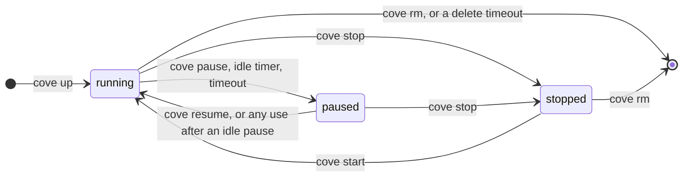
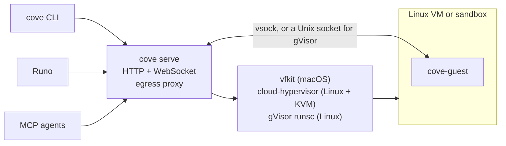

<div align="center">

# Cove

### Your own cloud computers for coding agents.

Real Linux VMs that boot in seconds, pause to disk, snapshot while running and keep your keys out of reach.<br/>
On your Mac, your server or a $10 VPS. Driven from a CLI, an HTTP API, MCP or [Runo](https://github.com/deltalark/runo).

[](https://github.com/deltalark/cove/actions/workflows/ci.yml)
[](LICENSE)


[Install](#install) · [Tour](#a-quick-tour) · [With Runo](#cove-and-runo) · [Where it runs](#where-cove-runs) · [Secrets](#secrets-and-the-allowlist) · [Reference](#reference) · [How it works](#how-it-works) · [Roadmap](#roadmap)

</div>

```console
$ curl -fsSL https://raw.githubusercontent.com/deltalark/cove/main/scripts/install.sh | sh
$ cove sh
root@dev:~# cargo test
```

Coding agents are most useful when you let them run anything, and most dangerous for the same reason. Cove gives every agent, and every person, a real Linux machine of its own: it boots in seconds, keeps its state, sees only the folders you share, reaches only the hosts you allow, and never holds your API keys.

## Why Cove

<table>
<tr>
<td width="50%" valign="top">

**Real VMs, not containers**<br/>
Debian 13 with its own kernel, and you are root. Apple's Virtualization.framework on a Mac, cloud-hypervisor on Linux with KVM, gVisor on a VPS without it.

</td>
<td width="50%" valign="top">

**Pause to disk, wake on use**<br/>
A paused VM keeps its memory and running programs, and on Linux it uses no RAM at all. Idle VMs pause themselves, and the next command or port visit wakes them in about a second.

</td>
</tr>
<tr>
<td valign="top">

**Snapshots**<br/>
Save a VM while it runs and start new ones from it. Set a project up once with `cove snapshot build`, and every VM after that starts ready.

</td>
<td valign="top">

**Keys never enter the VM**<br/>
Inside, your API keys are placeholders. Cove's proxy swaps in the real values only on HTTPS requests to the hosts each key belongs to.

</td>
</tr>
<tr>
<td valign="top">

**Only the hosts you allow**<br/>
`--network allowlist` gives a VM no network device at all: it reaches only its allowlist, through Cove's proxy, and every attempt is logged.

</td>
<td valign="top">

**Work that outlives your laptop**<br/>
`cove spawn` starts a named process that keeps running when you disconnect. `cove attach` replays what you missed and follows on.

</td>
</tr>
<tr>
<td valign="top">

**Built for agents**<br/>
An MCP server lets any agent make its own VMs, run commands and background jobs, move files, share ports, pause and snapshot.

</td>
<td valign="top">

**One binary, your hardware**<br/>
One install line on a Mac or Linux box. No account, no per-second bill. Pair Runo or another computer with a one-time code.

</td>
</tr>
</table>

## Install

<table>
<tr>
<th align="left">On a Mac (Apple Silicon)</th>
<th align="left">On a Linux server or VPS</th>
</tr>
<tr>
<td valign="top">

```sh
curl -fsSL https://raw.githubusercontent.com/deltalark/cove/main/scripts/install.sh | sh
```

Installs vfkit with Homebrew if needed and starts `cove serve` at login.

</td>
<td valign="top">

```sh
curl -fsSL https://raw.githubusercontent.com/deltalark/cove/main/scripts/install.sh | sudo sh
```

Root, because VMs with a network need it. Installs cloud-hypervisor with KVM, or gVisor without it, and a systemd service.

</td>
</tr>
</table>

Then check the machine with `cove doctor`, which lists what each backend needs, what is missing and how to fix it.

<details>
<summary><b>What the install script does, and its options</b></summary>

- Puts `cove` and the guest agent in `~/.cove/bin`, from the latest release, or builds them from source with cargo when no release fits. Building from source needs [Rust](https://rustup.rs); the script fetches the rest for the guest agent (zig and cargo-zigbuild on a Mac, musl-tools on Linux).
- Links `cove` into `/opt/homebrew/bin` or `/usr/local/bin`, so apps such as Runo find it.
- **Mac:** installs vfkit with Homebrew if it is missing, and starts `cove serve` at login with a launchd agent.
- **Linux with KVM:** installs cloud-hypervisor (the official static build), and virtiofsd, iptables and iproute2 from your distribution.
- **Linux without KVM:** asks to install gVisor (the official release, checksum checked). Say no and you get just the CLI, to drive a Cove server elsewhere.
- On Linux, installs a systemd service for `cove serve`, runs `cove doctor` and pulls the Debian 13 image. gVisor's image comes from Docker Hub, or Google's mirror of it when Docker Hub's pull limit refuses a shared VPS address, with every layer checked against its digest.

Running it again upgrades in place; your VMs, images and keys in `~/.cove` are left alone. Options go after `sh -s --`, for example `| sh -s -- --no-service`: `--prefix DIR`, `--version TAG`, `--listen ADDR`, `--no-service`, `--no-image`, `--no-link`, `--no-deps`, `--gvisor` / `--no-gvisor`, `--from-source`, `--from-file TARBALL`.

**Uninstall** with `--uninstall`. It stops the service and removes the binaries and keeps `~/.cove`; add `--purge` to stop every VM and delete `~/.cove` too.

</details>

## A quick tour

**A shell in a fresh machine.** `cove sh` makes a VM called `dev` the first time, and opens a root shell in it every time after.

```sh
cove sh                                     # create or resume "dev" and open a shell
cove up app --mount ~/code/app:/work        # or make one with options, sharing a folder
cove shell app --cwd /work                  # edit on your Mac, build in the VM
```

**Pause, resume, and pause by itself.** Memory and running programs are kept. On Linux the memory goes to disk, so a paused VM costs only disk space.

```sh
cove pause app                              # frozen; on Linux it now uses no RAM
cove resume app                             # carries on where it was, in about a second
cove auto-pause app 30                      # pause after 30 idle minutes; using it wakes it
cove timeout app 2h --on-timeout delete     # a scratch VM that cleans itself up
```

**Set a project up once.** Snapshots hold a VM's installed software and files. The `universal` template has Docker, Node, Python, Go, Rust, gh, Claude Code and Codex.

```sh
cove snapshot build universal --script scripts/templates/universal.sh
cove settings set snapshot=universal auto_pause_minutes=30   # new VMs start from it
cove snapshot save app --name app-ready                       # save any VM, even running
cove up agent-2 --snapshot app-ready
```

**Let agents loose, safely.** Keep keys out of the VM and limit where it can connect.

```sh
cove up agent --network allowlist --allow @dev --secret ANTHROPIC_API_KEY --secret GH_TOKEN
cove egress agent                           # what it may reach, and what it tried to
```

**Keep work running without you.**

```sh
cove spawn app tests -- cargo test          # keeps going after you disconnect
cove attach app tests                       # replay what you missed, then follow
cove forward app 3000                       # a dev server, on a localhost URL
```

Every VM moves through the same few states:



## Cove and Runo

Cove is built to work hand in hand with [Runo](https://github.com/deltalark/runo), the native app for running coding agents side by side. In Runo, a Cove server is a **Connection**, and every session picks where it **Runs on**: your Mac, or any connection, moving between them between agent turns.

**Set it up from Runo.** Settings › Connections finds the Cove on your Mac by itself, and installs it if it isn't there. For a server:

1. Install Cove on the server with the Linux line above (Runo's Cove settings have it ready to copy).
2. Run `cove pair` there. It prints a one-time code, good for 10 minutes.
3. In Runo, add a Cove connection with the server's URL and that code, and press **Pair**. Runo gets a key of its own, which `cove keys rm` on the server revokes.

The API is plain HTTP on `127.0.0.1:7457` by default, so reach a server through an SSH tunnel (`ssh -L 7457:127.0.0.1:7457 my-server`, then `http://127.0.0.1:7457`), or put an HTTPS reverse proxy in front of it before opening it up with `--listen`. Another computer's CLI connects the same way: `cove login <url> <code>`.

**What a session gets:**

- **On your Mac's Cove**, a VM of its own with the worktree shared in at the same path. The agent and terminals run in the VM; git, diffs and pull requests keep running on the Mac against the same files, so moving between the two is instant.
- **On a remote Cove**, the VM keeps its own copy of the worktree, synced through git after every agent turn, uncommitted changes and the agent's conversation included. Close your laptop and the turn keeps running as a Cove named process; when Runo opens again it reattaches and brings the work back.
- **When idle**, a session's VM pauses (or stops, if you prefer), and the next message wakes it.
- **Agents use Cove too.** Through `cove mcp`, an agent can make scratch VMs of its own: to research without touching the worktree, run untrusted code with the network off, or hand a heavy build to a bigger machine.

Runo checks `/v1/health` to see what a server supports, so an older Cove keeps working for what it can do.

## Where Cove runs

| Host | Backend | Isolation | Pause |
| --- | --- | --- | --- |
| macOS on Apple Silicon | `vfkit`: Apple's Virtualization.framework | A real VM with its own kernel | In memory |
| Linux with KVM (bare metal, or a VPS with nested virtualization) | `cloud-hypervisor` | A real VM with its own kernel | To disk, about 1 s each way |
| Linux without KVM (most cheap VPS plans) | `gvisor`: gVisor sandboxes | gVisor's own kernel in user space between the VM's processes and the host's | To disk, under half a second |

`--backend auto`, the default, picks the strongest one the machine has, and `cove doctor` shows which. Each VM keeps the backend it was made with. A VM whose shared folders are in use when it pauses keeps its memory in RAM, so nothing it has open breaks.

On Linux, VMs with the network on get their own /30 in `10.177.0.0/16` with NAT to the internet. They can't reach each other, the host's own services, or the cloud metadata endpoint (`169.254.0.0/16`), which on many providers hands out the server's credentials. gVisor sandboxes boot in about a second and need no KVM, but don't enforce `--disk` and have no systemd inside.

## Secrets and the allowlist

```console
$ export ANTHROPIC_API_KEY=sk-ant-…
$ cove up agent --mount ~/code/app:/work --network allowlist --allow @dev \
    --secret ANTHROPIC_API_KEY --secret GH_TOKEN
$ cove exec agent -- sh -c 'echo $ANTHROPIC_API_KEY'
sk-ant-api03-cove5f0c…            # a placeholder, not your key
$ cove egress agent
Network: allowlist. Reaches only: @dev
Secret ANTHROPIC_API_KEY goes only to api.anthropic.com
Secret GH_TOKEN goes only to github.com, api.github.com

api.anthropic.com                          443  allowed, added ANTHROPIC_API_KEY
registry.npmjs.org                         443  allowed
evil.example                               443  BLOCKED: not on this VM's allowlist
```

- **The proxy runs in `cove serve`, outside the VM.** Commands in the VM get `HTTP_PROXY` and `HTTPS_PROXY` pointing at `127.0.0.1:3128` inside it, where the guest agent hands each connection to the server over its own channel. So an `allowlist` VM needs no network device.
- **Secrets** come from your environment (`--secret NAME`, never a value on the command line). The VM gets a placeholder that keeps the key's public prefix. For that secret's hosts, the proxy terminates TLS with Cove's own authority (installed in the VM), swaps the placeholder in the request headers, `Basic` credentials included, and sends the request on over TLS. Well-known names know their hosts (`ANTHROPIC_API_KEY`, `CLAUDE_CODE_OAUTH_TOKEN`, `OPENAI_API_KEY`, `OPENROUTER_API_KEY`, `GEMINI_API_KEY`, `GH_TOKEN`, `GITLAB_TOKEN` and more); name others with `--secret NAME@host,host`.
- **Everything else passes straight through** as a plain `CONNECT` tunnel: the proxy checks the host name and never sees the traffic.
- **Never reachable:** the host's own addresses and link-local ones such as the cloud metadata service. Private networks only for hosts allowed by exact name, so `*` doesn't open your LAN.
- **Limits:** secrets go in request headers only, over HTTPS, on HTTP/1.1 (streaming responses work; WebSocket upgrades don't yet). With `--network full`, secrets still work but the allowlist isn't enforced.

On purpose, MCP can't give a VM secrets or change its allowlist: an agent shouldn't be able to widen its own sandbox. People do that with the CLI or the API.

## Reference

<details>
<summary><b>CLI</b></summary>

| Command | What it does |
| --- | --- |
| `cove sh [name]` | Open a shell in `name` (default `dev`), creating, starting or resuming it as needed |
| `cove up <name> [options]` | Create and start a VM (options below) |
| `cove ls [--label K=V]` · `cove show <name>` | List VMs (only those with every label given), or show one |
| `cove start` · `stop` · `rm <name>` | Start, stop or delete a VM |
| `cove pause` · `resume <name>` | Pause a VM with its memory and processes kept, and carry on |
| `cove auto-pause <name> <minutes>` | Pause it once idle that long; `0` turns it off |
| `cove timeout <name> <30m\|2h\|0> [--on-timeout pause\|delete]` | Pause or delete it that long from now, once; `0` clears it |
| `cove label <name> K=V... [--rm K]` | Set or remove labels |
| `cove rename <from> <to>` · `cove copy <from> <to>` | Rename a stopped VM, or copy one |
| `cove snapshot save <vm> --name N` · `ls` · `rm N` | Save a VM (while it runs, too), list and delete snapshots |
| `cove snapshot build N --script FILE` | Run a setup script in a fresh VM and save the result |
| `cove exec <name> [-t] [--cwd DIR] [-e K=V]... -- <cmd...>` | Run a command and wait for it |
| `cove shell <name> [--cwd DIR]` | Open an interactive shell |
| `cove spawn <name> <proc> [-t] [-a] -- <cmd...>` | Start a named background process |
| `cove attach <name> <proc> [--from BYTES]` | Reattach to a process and replay its output |
| `cove procs <name>` · `cove kill <name> <proc>` | List or stop processes |
| `cove push <name> <local> <remote>` · `cove pull <name> <remote> <local>` | Copy files in and out |
| `cove ports <name>` · `cove forward <name> <port>` | List ports and forward one |
| `cove egress <name>` · `cove allow <name> [rules...]` | What a VM may reach and tried to; replace its allowlist |
| `cove settings show` · `set K=V...` · `unset K...` | The server's defaults for new VMs |
| `cove pair` · `cove login <url> <code>` · `cove logout` | Connect Runo or another computer with a one-time code |
| `cove keys ls` · `create <name>` · `rm <id>` | Named API keys, one per person or device |
| `cove image ls` · `cove image pull <image> [--backend B]` | List and download base images |
| `cove serve [--listen 127.0.0.1:7457]` · `cove doctor` · `cove key` | Run the server, check the host, print its key |
| `cove mcp` · `cove version` | The MCP server over stdio; versions and the server's features |

Add `--json` to any command for machine-readable output, and `--host URL` to talk to another server. `cove exec` and `cove shell` start a stopped VM, or resume a paused one, by themselves, and with `--create` make a missing one. `cove exec` passes stdin through byte for byte, so `git upload-pack` and friends run through it unchanged.

</details>

<details>
<summary><b><code>cove up</code> options</b></summary>

| Option | Default | What it does |
| --- | --- | --- |
| `--snapshot NAME` · `--image NAME` | `debian-13` | Start from a snapshot, or a base image |
| `--cpus N` · `--memory MB` · `--disk GB` | `2` · `4096` · `20` | Size |
| `--mount HOST:GUEST[:ro]` | | Share a folder; repeat for more |
| `--backend NAME` | `auto` | `auto`, `vfkit`, `cloud-hypervisor` or `gvisor` |
| `--network full\|off\|allowlist` | `full` | `off` and `allowlist` give the VM no network device; `allowlist` reaches its `--allow` hosts through Cove's proxy |
| `--allow RULE` | `@dev` with `allowlist` | `example.com`, `*.example.com`, `*`, or a preset: `@dev` (git hosts, registries, Debian mirrors, model APIs) or `@agents` (model APIs and sign-in hosts) |
| `--secret NAME[@HOSTS]` | | Keep `NAME` from your environment out of the VM |
| `--auto-pause MINUTES` · `--idle-stop MINUTES` | off | Pause, or stop, after that many minutes with no commands, streams, forwarded connections or running named processes |
| `--timeout DURATION` `[--on-timeout pause\|delete]` | | Pause or delete it that long from now: `30m`, `2h`, up to `24h` |
| `--label KEY=VALUE` · `--tag T` | | Metadata to find it by (up to 32 labels) |
| `--ephemeral` | | Delete the VM when it stops |

Options left out come from the server's settings (`cove settings`), then the defaults above.

</details>

<details>
<summary><b>HTTP API</b></summary>

Every request carries `Authorization: Bearer <key>`: the server's own key (`cove key`), or a named key from `cove keys create` or pairing. Named keys are stored as hashes and revoked one by one.

| Method | Path | Notes |
| --- | --- | --- |
| `GET` | `/v1/health` | No auth. `ok, version, protocol, backend, features` |
| `GET` `POST` | `/v1/vms` | POST takes `name, image, snapshot, cpus, memory_mb, disk_gb, mounts, ephemeral, tags, labels, backend, network, allow, secrets, auto_pause_minutes, idle_stop_minutes, timeout_minutes, on_timeout, start`; what it leaves out comes from `/v1/settings`. GET takes `?label=key=value`, repeated |
| `GET` `PATCH` `DELETE` | `/v1/vms/{name}` | PATCH takes `labels`, `auto_pause_minutes`, `idle_stop_minutes` and `timeout` (`{minutes, action}`); `null` clears one |
| `POST` | `/v1/vms/{name}/start`, `/stop`, `/pause`, `/resume`, `/copy`, `/rename` | `copy` and `rename` take `{"to": ...}` |
| `POST` | `/v1/vms/{name}/exec` | Runs to completion: `code, stdout, stderr` |
| `GET` (WebSocket) | `/v1/vms/{name}/stream` | First message is an `exec`, `spawn` or `attach` request; then frames out, input in |
| `GET` · `DELETE` | `/v1/vms/{name}/procs` · `/procs/{proc}?signal=` | |
| `GET` `PUT` · `GET` | `/v1/vms/{name}/files?path=` · `/dir?path=` | Raw bytes; PUT takes `&mode=755` |
| `GET` · `POST` `DELETE` | `/v1/vms/{name}/ports` · `/forwards`, `/forwards/{port}` | |
| `GET` `PUT` | `/v1/vms/{name}/egress` | Policy, secrets' names and hosts, and the latest 200 connections. PUT `{"allow": [...]}` replaces the allowlist |
| `POST` · `GET` `DELETE` | `/v1/vms/{name}/snapshots` · `/v1/snapshots`, `/v1/snapshots/{name}` | Save a VM `{name, description}`; list and delete |
| `GET` `PUT` | `/v1/settings` | Defaults for new VMs: `cpus, memory_mb, disk_gb, backend, network, allow, auto_pause_minutes, idle_stop_minutes, snapshot` |
| `GET` `POST` · `DELETE` | `/v1/keys` · `/v1/keys/{id}` | POST `{name}` returns a new key once |
| `POST` | `/v1/pair/codes` | A one-time code, good for 10 minutes |
| `POST` | `/v1/pair` | No auth. `{code, name}` returns `{id, name, key, server}`. Ten wrong codes in a row lock pairing for 10 minutes |
| `GET` · `POST` | `/v1/images` · `/v1/images/{name}/pull?backend=` | |

A VM's `state` is `stopped`, `starting`, `running`, `stopping` or `paused`. A paused one says why in `paused_by` (`user`, `idle` or `timeout`) and has `paused_to_disk: true` when its memory is on disk. An idle pause wakes on the next request; the others answer 409 until resumed.

`/v1/health` lists `features`, such as `pause`, `snapshots`, `pair` and `backend:gvisor`. Features are only ever added, so check for the one you need rather than comparing versions. The stream's frames and requests are the types in [`crates/proto`](crates/proto/src/lib.rs).

```sh
curl -s -H "Authorization: Bearer $(cove key)" -H "Content-Type: application/json" \
  -d '{"cmd":["uname","-a"]}' http://127.0.0.1:7457/v1/vms/dev/exec
```

</details>

<details>
<summary><b>MCP tools</b></summary>

```json
{ "mcpServers": { "Cove": { "command": "cove", "args": ["mcp"] } } }
```

| Tool | What it does |
| --- | --- |
| `vm_list` · `vm_create` | List VMs; create one (`name`, and optionally `cpus`, `memory_mb`, `ephemeral`, `network`, `allow`, `auto_pause_minutes`, `idle_stop_minutes`, `snapshot`, `timeout_minutes`) |
| `vm_exec` | Run a command (`bash -lc`) and wait for it |
| `vm_spawn` · `vm_logs` · `vm_kill` | Background processes: start, read their output so far, signal |
| `vm_read_file` · `vm_write_file` | Files |
| `vm_share_port` | Forward a port to the host |
| `vm_pause` · `vm_resume` · `vm_stop` · `vm_start` | Lifecycle |
| `vm_snapshot_save` · `vm_snapshot_list` · `vm_copy` | Snapshots and copies |
| `vm_egress` · `vm_destroy` | What a VM reached; delete it |

</details>

## How it works



- **`cove serve`** keeps everything in `~/.cove`: VM records and disks (copy-on-write clones of a base image, copied without filling their holes), snapshots, settings and keys. For real VMs it builds a small cloud-init seed on every start that installs the guest agent.
- **`cove-guest`** is a static Linux binary inside each VM. It runs commands, terminals, file operations and port pipes, one request per connection.
- **VMs are their own processes**, so restarting the server doesn't stop them; it finds them again from `run.json`. A VM paused to disk has no process at all, and comes back after a restart too.
- **Pausing to disk** uses cloud-hypervisor's snapshot and restore (shared folders are unplugged around it) and gVisor's checkpoint and restore (the guest agent lets go of its host sockets first).

| Crate | Role |
| --- | --- |
| [`crates/cli`](crates/cli) | The `cove` binary: server, CLI client and MCP server |
| [`crates/core`](crates/core) | VM manager, backends, images, snapshots, settings, keys and the egress proxy |
| [`crates/guest`](crates/guest) | `cove-guest`, the agent inside each VM |
| [`crates/proto`](crates/proto) | Wire types shared by server, client and guest |

## Roadmap

**Shipped**

- [x] Three backends: vfkit on a Mac, cloud-hypervisor with KVM, gVisor without it, each checked end to end with `scripts/smoke-vm.sh`
- [x] One-line install and upgrade, with a launchd agent or a systemd service
- [x] Shared folders, background processes that outlive the connection, port forwarding, an MCP server
- [x] Secrets kept out of VMs, and an egress allowlist with a log
- [x] Pause and resume, to disk on Linux; auto-pause with wake on use; timeouts, labels and rename
- [x] Snapshots, `cove snapshot build` and a `universal` template
- [x] Server settings, named keys and pairing codes; Runo Connections with turns that outlive your laptop

**Next**

- [ ] SSH from any terminal: a gateway with keys and paste-anywhere tokens
- [ ] Public HTTPS ports on your own domain, with wake on visit
- [ ] Secrets stored on the server and changeable on a running VM
- [ ] A desktop agents can drive (computer use), with share links
- [ ] A TypeScript SDK and a web dashboard
- [ ] Pause to disk on a Mac

## Development

Building needs [Rust](https://rustup.rs), plus [zig](https://ziglang.org) and [cargo-zigbuild](https://github.com/rust-cross/cargo-zigbuild) for the guest agent on a Mac (or `musl-tools` on Linux).

```sh
cargo build --release
scripts/build-guest.sh                  # the agent that runs inside VMs, into ~/.cove/guest
target/release/cove serve &             # data lives in ~/.cove
target/release/cove doctor
cargo build --workspace && cargo test --workspace
```

`scripts/install.sh --from-source` does the same from a checkout, and `scripts/smoke-vm.sh` boots real VMs on any backend and checks them end to end.

<details>
<summary><b>Test switches</b></summary>

The end-to-end tests use the `host` backend, which runs the guest agent as a normal process on your machine with **no isolation**. It is only allowed when the server runs with `COVE_ALLOW_HOST_BACKEND=1`.

- `COVE_GVISOR_E2E=1` adds a test that boots a real gVisor sandbox (root, `runsc`, a static guest agent in `COVE_GUEST_BINARY`).
- `COVE_GVISOR_PLATFORM` forces gVisor's platform; `COVE_CH_FIRMWARE` points cloud-hypervisor at your own firmware.
- `COVE_IDLE_CHECK_SECS` changes how often idle timers and timeouts are checked (30 s), and `COVE_IDLE_MINUTE_SECS` shortens what counts as a minute.

</details>

## License

[MIT](LICENSE)
