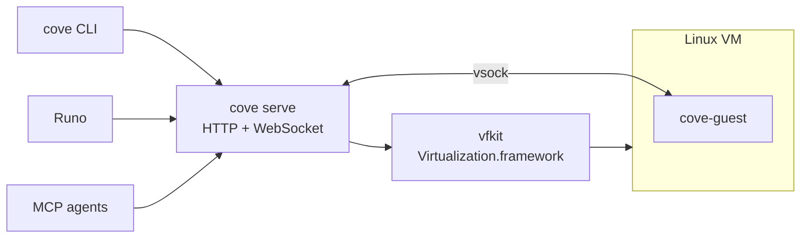

<div align="center">

# Cove

**Self-hosted microVMs for people and coding agents.**

Fast, persistent Linux VMs on your Mac or your own server,
driven from a CLI, an HTTP API or MCP.

[](https://github.com/deltalark/cove/actions/workflows/ci.yml)
[](LICENSE)


[Why Cove](#why-cove) · [Quick start](#quick-start) · [CLI](#cli) · [API](#http-api) · [MCP](#mcp) · [Runo](#cove-and-runo) · [How it works](#how-it-works)

</div>

---

```console
$ cove up dev --mount ~/code/myapp:/work
$ cove shell dev --cwd /work
root@dev:/work# cargo test
```

## Why Cove

Coding agents are most useful when you let them run commands freely, and most dangerous for the same reason. Cove gives every agent, or every person, a real Linux machine of its own that boots in seconds, keeps its state, and can only see what you hand it.

- **Real Linux VMs.** Debian 13, and you are root. Every VM boots from a shared base image, and its disk is a copy-on-write clone, so a new VM costs almost no disk until it changes things.
- **Live shared folders.** Share host folders into the VM with virtio-fs. Edit on your Mac and build in the VM, or the other way round.
- **Processes that outlive your connection.** `cove spawn` starts a named process in the VM. Disconnect, come back later, and `cove attach` replays what you missed and keeps streaming. Agents keep working while your laptop sleeps.
- **Ports in one command.** See what is listening inside a VM and forward it to your machine.
- **Built for agents.** An MCP server lets any agent create VMs, run commands, start and watch background jobs, move files and share ports.
- **Real isolation.** A VM sees only the folders you share and the credentials you pass. Commands an agent runs there can't touch your home folder, keychain or SSH keys. Turn its network off entirely for code you don't trust.
- **Stops when you're done.** Give a VM an idle timer and it stops by itself once nothing has used it for that long, so forgotten agent VMs don't hold on to memory.

## Quick start

macOS on Apple Silicon. You need [Rust](https://rustup.rs), [Homebrew](https://brew.sh), and [zig](https://ziglang.org) with [cargo-zigbuild](https://github.com/rust-cross/cargo-zigbuild) to build the guest agent.

```sh
brew install vfkit                     # the Virtualization.framework launcher
cargo build --release
scripts/build-guest.sh                 # the agent that runs inside VMs

target/release/cove serve &            # the server; data lives in ~/.cove
target/release/cove doctor             # check that everything is in place
target/release/cove image pull debian-13
target/release/cove up dev --mount ~/code/myapp:/work
target/release/cove shell dev --cwd /work
```

Want to check a fresh install end to end? `scripts/smoke-vm.sh` boots a VM and tests exec, shared folders, networking, ports and restarts.

## CLI

| Command | What it does |
| --- | --- |
| `cove serve [--listen 127.0.0.1:7457]` | Run the server |
| `cove doctor` | Check the host setup |
| `cove key` | Print the API key |
| `cove image ls` · `cove image pull <image>` | List and download base images |
| `cove up <name> [options]` | Create and start a VM (options below) |
| `cove ls` · `cove show <name>` | List VMs, or show one |
| `cove start <name>` · `cove stop <name>` · `cove rm <name>` | Start, stop or delete a VM |
| `cove copy <from> <to>` | Clone a VM |
| `cove exec <name> [-t] [--cwd DIR] [-e K=V]... -- <command...>` | Run a command and wait for it |
| `cove shell <name> [--cwd DIR]` | Open an interactive shell |
| `cove spawn <name> <proc> [-t] [-a] -- <command...>` | Start a named background process |
| `cove attach <name> <proc> [--from BYTES]` | Reattach to a process and replay its output |
| `cove procs <name>` · `cove kill <name> <proc>` | List or stop processes |
| `cove push <name> <local> <remote>` · `cove pull <name> <remote> <local>` | Copy files in and out |
| `cove ports <name>` · `cove forward <name> <port>` | List ports and forward one |
| `cove mcp` | Run the MCP server over stdio |
| `cove version` | Print the client's version, and the server's version and features |

`cove up` takes:

| Option | Default | What it does |
| --- | --- | --- |
| `--cpus N` | `2` | Virtual CPUs |
| `--memory MB` | `4096` | Memory |
| `--disk GB` | `20` | Disk size |
| `--mount HOST:GUEST[:ro]` | | Share a folder; repeat for more |
| `--network full\|off` | `full` | `full` is NAT to your network and the internet. `off` gives the VM no network device at all; Cove still reaches it over vsock |
| `--idle-stop MINUTES` | off | Stop the VM after this many minutes with no commands, open streams, forwarded connections or running named processes |
| `--ephemeral` | | Delete the VM when it stops |
| `--tag T` | | Free-form labels; repeat for more |

`cove exec` and `cove shell` start a stopped VM by themselves. With `--create` they also create a missing one, taking `--mount`, `--cpus`, `--memory`, `--network` and `--idle-stop` as above. `cove ls` shows each VM's network policy and idle timer.

`cove exec` passes stdin through byte for byte and closes the command's stdin when yours ends, so `echo hi | cove exec dev -- cat` prints `hi`, and binary protocols such as `git upload-pack` run through it unchanged. Output waits for a slow reader instead of being dropped.

Add `--json` to any command for machine-readable output, and `--host URL` to talk to another Cove server.

## HTTP API

Every request carries `Authorization: Bearer <key>`. The key is created on first start in `~/.cove/api-key`, and `cove key` prints it.

| Method | Path | Notes |
| --- | --- | --- |
| `GET` | `/v1/health` | No auth. `ok, version, protocol, backend, features` |
| `GET` | `/v1/images` | |
| `POST` | `/v1/images/{name}/pull` | |
| `GET` `POST` | `/v1/vms` | POST takes `name, image, cpus, memory_mb, disk_gb, mounts, ephemeral, tags, network, idle_stop_minutes, start` |
| `GET` `DELETE` | `/v1/vms/{name}` | |
| `POST` | `/v1/vms/{name}/start`, `/stop`, `/copy` | |
| `POST` | `/v1/vms/{name}/exec` | Runs to completion and returns `code, stdout, stderr` |
| `GET` (WebSocket) | `/v1/vms/{name}/stream` | First message is an `exec`, `spawn` or `attach` request; then frames out, input in |
| `GET` | `/v1/vms/{name}/procs` | |
| `DELETE` | `/v1/vms/{name}/procs/{proc}` | `?signal=` |
| `GET` `PUT` | `/v1/vms/{name}/files?path=` | Raw bytes; PUT takes `&mode=755` |
| `GET` | `/v1/vms/{name}/dir?path=` | |
| `GET` | `/v1/vms/{name}/ports` | Listening ports and forwards |
| `POST` `DELETE` | `/v1/vms/{name}/forwards`, `/forwards/{port}` | |

The stream's frames and requests are the types in [`crates/proto`](crates/proto/src/lib.rs).

A VM's `network` is `"full"` (the default) or `"off"`, and `idle_stop_minutes` is a whole number of minutes, or left out for no timer. Both come back in every VM's status.

`/v1/health` tells a client what the server can do before it relies on it:

```json
{ "ok": true, "version": "0.1.0", "protocol": 1, "backend": "vfkit",
  "features": ["network", "idle-stop", "spawn", "attach", "forward", "copy", "files", "stdin-eof"] }
```

Features are only ever added, so check for the one you need rather than comparing versions.

```sh
curl -s -H "Authorization: Bearer $(cove key)" -H "Content-Type: application/json" \
  -d '{"cmd":["uname","-a"]}' http://127.0.0.1:7457/v1/vms/dev/exec
```

## MCP

Give any MCP-capable agent its own machines:

```json
{ "mcpServers": { "Cove": { "command": "cove", "args": ["mcp"] } } }
```

| Tool | What it does |
| --- | --- |
| `vm_list` | List VMs |
| `vm_create` | Create and start a VM: `name`, and optionally `cpus`, `memory_mb`, `ephemeral`, `network` (`full` or `off`) and `idle_stop_minutes` |
| `vm_exec` | Run a command and wait for it: `name`, `command`, `cwd` |
| `vm_spawn` | Start a named background process that keeps running: `name`, `proc`, `command`, `cwd` |
| `vm_logs` | A named process's output so far and whether it is still running, without waiting: `name`, `proc`, `from` (byte offset; each reply gives the next one) |
| `vm_kill` | Signal a named process: `name`, `proc`, `signal` (SIGTERM by default) |
| `vm_read_file` · `vm_write_file` | Read and write files |
| `vm_share_port` | Forward a port to the host |
| `vm_stop` · `vm_start` | Stop a VM, keeping its disk, or start it again |
| `vm_copy` | Copy a stopped VM to a new name: `name`, `to` |
| `vm_destroy` | Delete a VM |

Agents can use `vm_spawn` and `vm_logs` for anything slower than a quick command: a build, a test suite, a dev server. Shell commands run as `bash -lc`.

## Cove and Runo

Cove is built to work hand in hand with [Runo](https://github.com/deltalark/runo), the native app for running coding agents side by side. In Runo, a Cove server is a **Connection**: the one on your Mac, or a remote one added with its URL and API key (`cove key` on that machine prints it). Every session picks where it **Runs on**, your Mac or any connection, and can move between them at any time between agent turns.

**On your Mac's Cove**, a session gets a VM of its own and its worktree is shared into the VM at the same path. The agent, the worktree setup command and terminal tabs run in the VM, while git, diffs, commits and pull requests keep running on the Mac against the same files. Moving a session between the Mac and the VM is instant, because there is nothing to copy.

**On a remote Cove server**, the VM keeps its own copy of the worktree, and Runo syncs it in and out through git after every agent turn, uncommitted changes included. Git's data travels through `cove exec` itself, so the VM never needs access to GitHub just to sync. The agent's conversation travels with the worktree, so you can move a session from your laptop to a VM on a server, close the laptop, and later bring it back: the agent resumes the same conversation wherever it runs.

**Runo's Cove settings** choose each connection's VM size, its network policy (`full`, or `off` for agents that shouldn't reach the internet) and its idle stop, so VMs on a server stop by themselves once their sessions go quiet. Only the API keys you list reach a VM, and deleting a session deletes its VM.

**Agents use Cove too.** Through `cove mcp`, an agent in Runo can make scratch VMs of its own: to research something without touching the session's worktree, to run code it doesn't trust with the network off, or to hand a heavy build to a bigger machine with `vm_spawn` and check on it with `vm_logs`.

Runo checks `/v1/health` to see which of these a server supports, so an older Cove keeps working for what it can do.

## How it works



- **`cove serve`** keeps VM records in `~/.cove/vms/<name>/`, clones the base disk for each VM, and builds a small cloud-init seed disk on every start that installs the guest agent.
- **`cove-guest`** is a static Linux binary inside the VM. It listens on vsock port 1024 and handles commands, terminals, file operations and port pipes, one request per connection.
- **VMs are their own processes**, so restarting the server doesn't stop them; it finds them again from `run.json`.

| Crate | Role |
| --- | --- |
| [`crates/cli`](crates/cli) | The `cove` binary: server, CLI client and MCP server |
| [`crates/core`](crates/core) | VM manager, backends, images and the cloud-init seed |
| [`crates/guest`](crates/guest) | `cove-guest`, the agent inside each VM |
| [`crates/proto`](crates/proto) | Wire types shared by server, client and guest |

## Roadmap

Cove is early. Here today: the macOS backend, the guest agent, the API, the CLI and the MCP server, with per-VM network policy and idle stop. Coming next:

- [ ] Linux backend (cloud-hypervisor with KVM) for a VPS or bare metal
- [ ] HTTPS proxy with a private-by-default URL for every VM
- [ ] Sharing VMs and previews
- [ ] Pairing a remote Cove server with Runo
- [ ] Snapshots and a web dashboard

See [the full plan](docs/plan.md) for details and the security model.

## Development

```sh
cargo build --workspace && cargo test --workspace
```

The end-to-end tests use the `host` backend, which runs the guest agent as a normal process on your machine with **no isolation**. It is only allowed when the server runs with `COVE_ALLOW_HOST_BACKEND=1`, and exists so the whole stack can be tested without a hypervisor. It accepts `--network off` but can't enforce it: its commands share your machine's network.

The server checks for idle VMs every 30 seconds. `COVE_IDLE_CHECK_SECS` changes that, and `COVE_IDLE_MINUTE_SECS` shortens what counts as a minute, so tests don't wait for real ones.

## License

[MIT](LICENSE)
